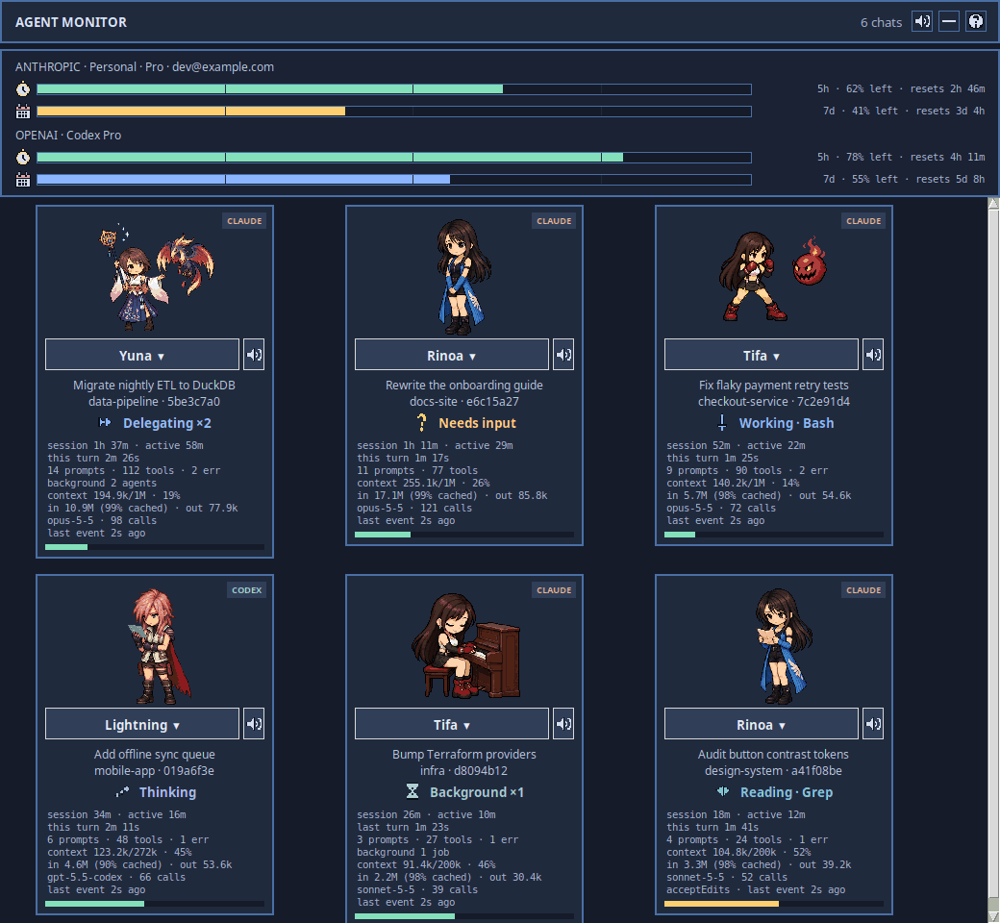

# Agent Monitor

A small Linux desktop window that shows one animated card per active Claude Code or Codex chat. Cards appear and disappear with sessions, show what the agent is doing, and can use a different avatar for each chat. Ordinary playback uses local GIFs and does not call a model.



The preview is recorded from the real window, using placeholder chats, a placeholder account and made-up usage numbers. It shows six chats changing state, the `?` help panel, and a chat switching to a different avatar in the picker. The sprite GIFs, source sheets and MP3 themes are excluded from this repository; supply your own assets before running the window.

## What it shows

- Claude Code in VS Code terminals and Codex chats in the desktop app or VS Code extension.
- States such as thinking, reading, using a tool, delegating, waiting for permission, ready, and error.
- A stable avatar choice per chat, with optional randomized working scenes and an idle scene. Click the name under a card's avatar to open the picker and choose a different character for that chat.
- Account usage per provider, as two bars each: a clock for the 5-hour window and a calendar for the weekly one, with the share left and the time until reset.
- Per-chat details: session age, active time, prompt and tool counts, context used, tokens in and out, model, and calls. The lines button switches between full and compact cards. Prompt and tool contents are not stored by the monitor.
- A `?` help panel that explains every state icon, the usage bars, and the card details.

Codex chats can be detected from their local rollout metadata before hooks are trusted. Detailed Codex tool and permission states require approving the configured hooks in Codex's **Hooks need review** prompt or `/hooks`.

Tool states recognize Codex's dotted and MCP names. File and web reads use Reading; planning and waiting for tool output use Thinking; agent calls use Delegating; user questions use Needs input; edits, image generation and other commands use Working. For `exec` wrappers, the monitor briefly inspects explicit nested tool names and simple read-only shell commands such as `rg`, `cat` and `git diff`. Mixed or ambiguous commands stay Working. Only the resolved tool name is retained, never the supplied code or command arguments; long MCP prefixes are removed from the card label.

## Requirements

Linux, Python 3, Tkinter, and Pillow. The GUI needs a desktop display. The Claude Code and Codex integrations use local session files and lifecycle hooks; install only the integration you use.

```bash
python3 -m pip install --user Pillow
python3 scripts/monitor.py install-hooks        # Claude Code
python3 scripts/monitor.py install-codex-hooks  # Codex; then approve in Codex
python3 scripts/monitor.py start
python3 scripts/monitor.py status
```

`install-hooks` and `install-codex-hooks` back up and merge the respective existing settings. `stop` closes the monitor. `uninstall-hooks` and `uninstall-codex-hooks` remove only this monitor's hook entries. The `SKILL.md` file describes the full command set and state mapping.

## Session health

Small marks after a card's status show when a chat needs attention; nothing shows while it's healthy. Hover a mark for its numbers. The `?` help panel lists them all:

| Mark | Means | What to do |
|---|---|---|
| yellow scroll | context getting long: 40% full, 150k tokens, or one compaction | `/compact` at a natural break, or a new chat for the next task |
| red scroll | too long: 70% full, 300k tokens, or two compactions | start a fresh chat; ask the old one for a handoff summary first |
| snowflake | idle over 5 minutes, so the prompt cache expired | the next message re-reads the whole context at full price; batch follow-ups while it's warm |
| burst | several tool errors this turn, or a very long run of tool calls | check whether the agent is stuck |

Only Needs input and Error chime by default, at most once a minute per chat. Add `"ready"` to `"chimes"` in `config.json` for a chime after every turn, or set `"chimes": []` for none. The thresholds are adjustable in `config.json` too; see SKILL.md.

## Remote machines

Chats running on another machine, for example Claude Code in a VS Code Remote-SSH window, can appear in this window too. SSH to the machine must already work without a password (a key, `ssh-agent`, or an alias in `~/.ssh/config`), and it needs Python 3.9 or newer.

```bash
python3 scripts/monitor.py remote-add devbox            # an SSH target or ~/.ssh/config alias
python3 scripts/monitor.py remote-add me@10.0.0.5 gpu   # with a display name
python3 scripts/monitor.py remote-remove gpu
```

`remote-add` copies `monitor.py` to `~/.agent-monitor/` on the machine and installs its hooks there; that copy only records events and never opens a window. The window keeps one SSH connection per machine and shows its chats as normal cards tagged with the machine's name, such as `CLAUDE · devbox`. If the connection drops, the cards stay, greyed and marked offline, until it reconnects. Run `remote-add` again after updating this repository to update the remote copy.

## Avatars

Copy your GIFs into `assets/<name>/` or register a separate local folder:

```bash
python3 scripts/monitor.py add-avatar "My Avatar" /absolute/path/to/gifs
```

Each avatar needs the five base GIFs listed in [assets/README.md](assets/README.md), or a complete `animations.json` mapping. `variants.json` may list extra working scenes (8–14 seconds per scene), thinking/reading scenes (12–20 seconds), delegation scenes (10–16 seconds), and quiet background scenes (25–45 seconds). Tifa alternates thoughtful and materia-study poses for thinking/reading; Yuna alternates Valefor and Shiva scenes for delegation. Idle and approval/error poses stay consistent. The personal development sprites are ignored by Git; a fresh clone needs its own local GIF assets. The local set is Tifa, Rinoa, Yuna and Lightning.

The local working rotation also includes these six-frame combat loops:

| Character | Scene | GIF basename |
|---|---|---|
| Tifa — FFVII | Dolphin Blow against a Sweeper | `dolphin-sweeper` |
| Rinoa — FFVIII | Angel Wing and Meteor against a T-Rexaur | `angel-wing-trexaur` |
| Yuna — FFX | Shiva's Diamond Dust against a Bomb, with Yuna beside her | `shiva-bomb` |
| Lightning — FFXIII | Army of One against a Behemoth King | `army-of-one-behemoth` |

These scenes rotate alongside the existing encounters. Their GIFs, source sheets and generation prompts stay local under `assets/<name>/` and `artwork/<name>/`; they are excluded from Git. Restart the monitor after adding scenes to a loaded avatar.

Local background variants include Tifa at a Seventh Heaven drinks counter, Rinoa playing fetch with Angelo, and Yuna embracing Valefor. Lightning's optional `busy_shift` scene plays once when her busy role changes, at most every 30 seconds, then returns to the activity animation. Input requests and errors interrupt it immediately.

## Music

Music files go in the character's folder and are ignored by Git. A `music.json` there names them by mood:

```json
{
  "field": ["Rinoa's Theme.mp3", "Balamb Garden.mp3", "Blue Fields.mp3"],
  "battle": ["Don't be Afraid.mp3", "Man with the Machine Gun.mp3"],
  "boss": ["Force Your Way.mp3", "The Extreme.mp3"],
  "victory": ["Victory Fanfare.mp3"],
  "victory_seconds": 7
}
```

The music follows your pace: how much of each usage window you'll have used by its reset if you carry on as you are. The bars show it as `pace N%`. The 5-hour window uses your last half hour; the weekly window uses your average since it began. The worse window decides, for the chat's own provider:

| Projected use at reset | Music |
|---|---|
| under 80% | field |
| 80–100% | battle |
| over 100%, or under 10% left | boss |

A mood only changes once the projection is 5 points past a threshold, so estimated readings don't make the music flip back and forth. The mood does not lock a playlist; it tilts the odds. Each time a track is drawn, field, battle or boss is picked by weight (calm: 70/22/8, battle: 25/50/25, boss: 8/27/65), so boss music turns up more as your allowance runs low and field music when plenty is left, while every list keeps a chance. A kind the character has no tracks for is skipped, and the drawn track plays to its end before the next draw.

Music starts once a task has run for 5 seconds, so quick replies stay silent. Music follows the whole turn rather than each state, because a chat switches between thinking and tool use every few seconds. When a task of 30 seconds or more finishes, the victory track plays its opening seconds and fades out; shorter tasks get a chime. Each list shuffles without repeating a track twice in a row. Every track also resumes where it stopped, so a run of short tasks moves through a long track instead of replaying its intro.

When a chat's turn is over but it still has background jobs or subagents running, its music keeps playing at a lower volume (`background_volume`, default half of `theme_volume`). A running task always takes priority over background music; with only background chats left, the music rotates between them, handing over when a track ends once a chat has played for at least 120 seconds, so no track is cut. Idle, ready, error and needs-input chats play nothing.

`pace_calm`, `pace_limit`, `boss_left`, `music_delay`, `victory_after`, `victory_seconds`, `theme_volume` and `background_volume` in `config.json` change the thresholds, timings and volume. `python3 scripts/monitor.py status` shows the playlists each character resolved.

## Development

```bash
python3 -m unittest discover -s tests
```

`tests/gui_smoke.py` also exercises the real Tk window when a display is available. It uses synthetic chats and temporary state.

To rebuild the preview with the local builder (`docs/build_demo.py` is ignored by Git, so it exists only in the original working copy) after supplying the local character GIFs:

```bash
python3 docs/build_demo.py
```

The script runs the real window against temporary state, with seeded placeholder chats, transcripts and usage readings. It makes no hook, network or credential access and plays no sound. Frames are read from the monitor's own X11 windows rather than the screen, so other windows on the desktop never appear in the GIF. It needs an X11 session with a compositor.

The monitor is a local visualization. It does not control either agent or the native ChatGPT Pet. It reads Claude Code's local OAuth credential only to request the same account usage reading Claude Code uses; it never logs or stores that token. Codex usage comes from Codex's own app server, which makes that request with Codex's login, and from Codex's local rollout files; the monitor never reads the OpenAI token.
